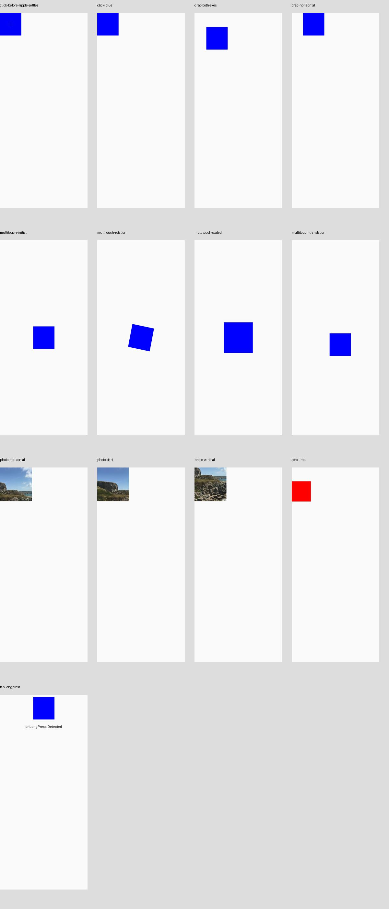

# GestureDemo — лабораторная работа №8

Учебные примеры по `55 Detecting Gestures in Compose.pdf` (12 страниц, разделы 1–11 и резюме). Проект: `C:\AndroidProjects\GestureDemo`, пакет `com.example.gesturedemo`. Отдельного PDF «ЛР №8» в комплекте нет; дополнительных требований не добавлено.

## Реализация

`MainActivity.kt` подключает `MainScreen` из Activity и Preview. Финальный MainScreen показывает **MultiTouchDemo**: синий Box 100 dp, поддерживающий масштабирование, поворот и перемещение. Экран выбора не добавлен. Все самостоятельные примеры сохранены в `Gestures.kt`; отдельные версии MultiTouchDemo восстановимы из Git.

| Этап / раздел лекции | Функция / поведение | Коммит |
|---|---|---|
| 1 / §2 | Empty Activity, MainScreen и Preview | `f41932f` |
| 2 / §3 | ClickDemo: Blue ↔ DarkGray | `b27ea4e` |
| 3 / §4 | TapPressDemo: onPress/onTap/onDoubleTap/onLongPress | `5fd7289` |
| 4 / §5 | DragDemo: draggable только X | `9f0ff09` |
| 5 / §6 | PointerInputDrag: detectDragGestures, X/Y | `ac22cfb` |
| 6 / §7 | ScrollableModifier: красный Box 90 dp, ручное смещение Y | `9342561` |
| 7 / §8 | ScrollModifiers: viewport 150 dp, Canvas 360×270 dp, обе прокрутки | `6fa9cf6` |
| 8 / §9 | MultiTouchDemo: scaleX/scaleY | `304b086` |
| 9 / §10 | rotationZ | `f9fabfc` |
| 10 / §11 | translationX/translationY | `98dffb4` |

`vacation.jpg` скопирован **без изменений** из `Lab08_Gestures/SOURCES`; SHA-256: `cff924b5300f0e3b8cd203720f3bbb0e9b2e873226e2fc8dd5f438a259df9ef7`.

Сохранены размеры, цвета, строки статусов и формулы лекции. Примеры вынесены из MainActivity в соседний `Gestures.kt` без изменения смысла; неиспользуемые аргументы лямбды на ранних этапах обозначены `_`. В Canvas используется именно `drawImage(image, topLeft=Offset.Zero)` из лекции, без добавления масштабирования фото. Scaffold передаёт padding через modifier, чтобы пример не попадал под системные панели.

## Запуск и сборка

Среда: minSdk 27, compile/targetSdk 37, AGP 9.4.1, Gradle Wrapper 9.6.0, Compose plugin 2.2.10, BOM 2026.02.01, JBR Android Studio 25. Проверено на **Pixel_API_34 (Android 14, API 34)**. Среда и другие проекты не изменялись.

Из каталога проекта в Windows cmd:

```bat
set "JAVA_HOME=C:\Program Files\Android\Android Studio\jbr"
gradlew.bat :app:assembleDebug :app:assembleDebugAndroidTest :app:lintDebug
"C:\Android\Sdk\platform-tools\adb.exe" -s emulator-5554 install -r app\build\outputs\apk\debug\app-debug.apk
"C:\Android\Sdk\platform-tools\adb.exe" -s emulator-5554 shell am start -n com.example.gesturedemo/.MainActivity
```

Локальный `local.properties` исключён из Git; при ручной настройке используйте `sdk.dir=C\:/Android/Sdk`. Для Gradle использовался существующий ASCII GRADLE_USER_HOME только в окружении дочернего процесса, без изменения глобальных параметров.

Предыдущий пример можно просмотреть по соответствующему коммиту в отдельной рабочей копии или заменить вызов внутри MainScreen на сохранённую функцию. Переписывать историю не требуется. Полные этапные APK/логи и SHA-256 находятся вне репозитория: `C:\AndroidProjects\_lab08_evidence`.

## Результаты

- Все десять кодовых этапов собраны, финальные app APK и test APK созданы; приложение запущено.
- **9 различных instrumented-тестов успешно выполнены по этапам** на Pixel_API_34. Это не единый повторный прогон всей финальной версии: уже успешные сценарии не повторялись. Поздние изменения ограничены добавлением rotation/translation.
- Проверены цвет при касании, одиночное/двойное/долгое нажатие, оба drag, вертикальная прокрутка, прокрутка фотографии по обеим осям, pinch, rotation и двухточечное перемещение.
- Lint: **0 ошибок, 8 предупреждений**, плюс подсказки по boxing состояния. Подробности и первоначальные неуспешные прогоны сохранены, а не скрыты.
- README, таблица приёмки и реальные скриншоты: [docs/VERIFICATION.md](docs/VERIFICATION.md), [сводка](docs/evidence/summary.json).



## Ограничения и ручная проверка

Мультитач проверен синтетическими двухточечными MotionEvent через Compose UI Test на настоящем Android-эмуляторе, **не Preview** и не физическим сенсором. Лекция рекомендует физическое устройство для translation: этот отдельный способ проверки остаётся **NOT VERIFIED**. На телефоне запустите приложение, коснитесь блока двумя пальцами и перемещайте их параллельно — блок должен следовать движению; также проверьте pinch и rotation. Ручное Ctrl-перетаскивание мышью в эмуляторе не проверялось.

Отдельный кратковременный статус `onPress Detected` реализован, но не проверялся отдельным удержанием указателя до отпускания; итоговые onTap/onDoubleTap/onLongPress подтверждены тестом. Состояние `remember` учебное, не сохраняется после пересоздания Activity. Ограничители масштаба/координат и сброс не добавлялись, поскольку их нет в лекции; после ухода блока за экран перезапустите приложение.

## Для защиты

1. `clickable` даёт простое нажатие и визуальную индикацию; `detectTapGestures` различает пресс, тап, двойной тап и удержание.
2. `draggable` сообщает дельту выбранной оси; `detectDragGestures` предоставляет двумерный Offset.
3. `scrollable` распознаёт движение, но визуальное смещение задаётся вручную. verticalScroll/horizontalScroll перемещают содержимое сами.
4. `rememberTransformableState` получает коэффициент масштаба, дельту смещения и дельту угла.
5. Масштаб умножается на scaleChange; угол и Offset накапливаются сложением.
6. `graphicsLayer` меняет отрисовку, а не исходный layout-размер 100 dp.

GitHub remote не настроен, публикация не выполнялась.
